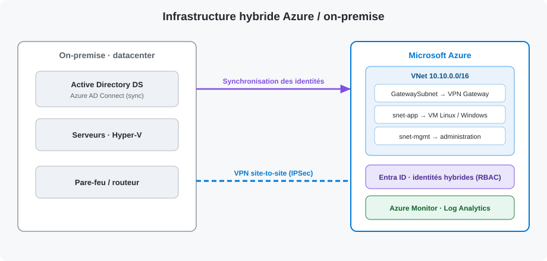

# Infrastructure cloud hybride Azure / on-premise

> **Partie cloud d'une infrastructure d'entreprise hybride** : relier le datacenter de l'entreprise (ses serveurs physiques) à Microsoft Azure, pour profiter du cloud tout en gardant les systèmes déjà en place.


---

## 💡 Objectif du projet ?

Une entreprise possède déjà ses **serveurs sur place** (dans ses locaux). Elle veut aussi utiliser le **cloud de Microsoft (Azure)** pour héberger de nouvelles machines, sans tout déménager d'un coup. Ce projet documente **comment on branche les deux mondes ensemble** pour qu'ils fonctionnent comme un seul réseau.

Une image simple : imaginez le datacenter de l'entreprise comme une **maison**, et Azure comme un **bureau loué à distance**. Ce projet consiste à :

1. 🔌 **Creuser un tunnel privé et sécurisé** (le VPN) entre la maison et le bureau, pour qu'ils se parlent comme s'ils étaient dans la même pièce.
2. 🏢 **Aménager le bureau à distance** : créer des espaces (réseaux), y installer des ordinateurs (machines virtuelles).
3. 🪪 **Utiliser le même badge d'accès partout** : les employés gardent un seul identifiant, qui fonctionne aussi bien à la maison que dans le bureau loué (identités synchronisées).
4. 📊 **Installer une caméra de surveillance** : tout voir depuis un seul écran qui consomme quoi, qu'est-ce qui plante, envoyer une alerte en cas de problème (supervision).

Le tout est **documenté étape par étape** et **automatisé** (des scripts refont le travail tout seuls), pour qu'un collègue puisse reproduire l'installation sans deviner.

## 🎯 Pourquoi c'est utile pour l'entreprise

| Besoin | Ce que ce projet apporte |
|--------|--------------------------|
| Grandir sans racheter du matériel | De nouvelles machines dans le cloud, en quelques minutes |
| Garder l'existant | Les serveurs sur place continuent de fonctionner, reliés au cloud |
| Sécurité | Connexion chiffrée, pas de machines exposées sur Internet, secrets protégés |
| Un seul identifiant par employé | Moins de mots de passe, moins d'erreurs, accès plus simples à gérer |
| Savoir ce qui se passe | Tableau de bord central + alertes automatiques |
| Refaire la même chose ailleurs | Scripts réutilisables : on redéploie à l'identique, sans erreur humaine |

## 🏗️ L'architecture en une image



```
  Les serveurs de l'entreprise                   Microsoft Azure (le cloud)
  « la maison »                                   « le bureau loué »
  ┌───────────────────────┐   Tunnel VPN  ┌──────────────────────────────────┐
  │ Annuaire des employés │◄═════════════►│ Réseau privé 10.10.0.0/16         │
  │ (Active Directory)    │  chiffré/IPSec│  ├─ zone « passerelle » → VPN      │
  │ Serveurs / Hyper-V    │               │  ├─ zone « applis » → VM Linux/Win │
  │ Azure AD Connect ─────┼──copie des────►│  └─ zone « admin »                │
  └───────────────────────┘   identités   │ Entra ID (mêmes comptes employés) │
                                           │ Supervision (écran de contrôle)   │
                                           └──────────────────────────────────┘
```

> En français : à gauche, ce que l'entreprise possède déjà. À droite, ce qu'on a mis en place dans le cloud. Au milieu, le **tunnel sécurisé** qui relie les deux.

## 🧩 Ce qui a été mis en place (et à quoi ça sert)

| Brique | Terme technique | À quoi ça sert, concrètement |
|--------|-----------------|------------------------------|
| Le réseau du cloud | VNet, sous-réseaux, NSG | Des « pièces » séparées et un videur à l'entrée : chaque machine est rangée au bon endroit et seul le trafic autorisé passe |
| Le tunnel | Passerelle VPN *site-to-site* (IPSec) | Le pont privé et chiffré entre les serveurs de l'entreprise et le cloud |
| Les machines | VMs **Linux** et **Windows Server** | Les ordinateurs du cloud qui font tourner les applications sans adresse publique, donc invisibles depuis Internet |
| Les identités | **Entra ID** + **Azure AD Connect**, rôles **RBAC** | Un seul compte par employé, valable partout ; chacun n'a accès qu'à ce qui le concerne |
| La surveillance | **Azure Monitor** + **Log Analytics** | L'écran de contrôle : mesures, journaux, et alertes automatiques (ex. « serveur surchargé ») |
| L'automatisation | Scripts **PowerShell** / **Python** | Faire l'inventaire et des rapports d'état tout seuls, au lieu de cliquer à la main |

## 📂 Ce que contient ce dépôt

```
azure-hybrid-infrastructure/
├── README.md                    # Ce document (la vue d'ensemble)
├── infra/
│   ├── azure-cli/               # ① Les actions, commande par commande (le plus lisible)
│   │   ├── 01-resource-group.sh #    Réserver l'espace de travail dans Azure
│   │   ├── 02-network.sh        #    Créer le réseau + le tunnel VPN
│   │   ├── 03-compute.sh        #    Installer les machines (Linux + Windows)
│   │   └── 04-monitoring.sh     #    Mettre en place la surveillance et les alertes
│   └── bicep/                   # ② La même chose en « plan automatisé » (IaC)
│       ├── main.bicep
│       └── README.md
├── scripts/
│   ├── powershell/…             # Inventaire des ressources Azure
│   └── python/…                 # Rapport d'état automatique
└── docs/                        # Les explications détaillées
    ├── architecture.svg         #    Le schéma
    ├── deployment-guide.md      #    Le déroulé complet, étape par étape
    ├── hybrid-identity.md       #    Le « même badge partout » (identités)
    └── monitoring.md            #    L'écran de contrôle (supervision)
```

> **Par où commencer ?** Lire ce README, puis ouvrir [`docs/deployment-guide.md`](docs/deployment-guide.md) : il raconte l'installation du début à la fin. Les scripts de [`infra/azure-cli/`](infra/azure-cli/) sont volontairement inclus et commentés.

## 🚀 Comment on déploie

Deux manières de reproduire l'installation (détail dans [`docs/deployment-guide.md`](docs/deployment-guide.md)) :

1. **Pas à pas (Azure CLI)** — on lance les scripts de [`infra/azure-cli/`](infra/azure-cli/) dans l'ordre. C'est **le plus pédagogique** : on voit chaque action se faire.
2. **En un bloc (Bicep)** — on décrit l'infra une fois dans un fichier, et Azure la construit d'un coup, toujours de la même façon. C'est **le plus fiable pour reproduire**.

> 🔒 **Sécurité** : aucun mot de passe n'est écrit dans le code. Les secrets (mots de passe, clé du tunnel VPN) sont gardés dans **Azure Key Vault**, le coffre-fort d'Azure.

## 🧰 Technologies utilisées

Azure (réseau, machines virtuelles, passerelle VPN, Entra ID, Azure Monitor) · Bicep · Azure CLI · PowerShell (module `Az`) · Python (`azure-identity`, `azure-mgmt-*`)

---
